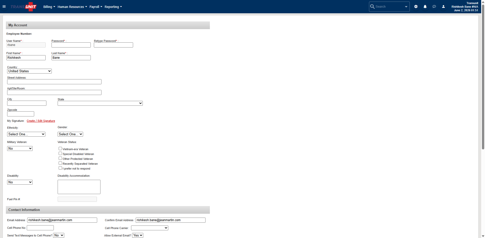

# After login landing

- **Menu section:** Home
- **URL:** https://transunit.traumasoft.com/main.php?a=user:account
- **Title:** My Account
- **Visited:** yes

## Buttons / actions (sample)

- Billing
- Human Resources
- Payroll
- Reporting

## Form fields (sample)

- `input` (text) search_input / search_input / Search
- `input` (text) user / user
- `input` (password) pass / pass
- `input` (password) password2 / password2
- `input` (text) first_name / first_name
- `input` (text) last_name / last_name
- `select` (select-one) country / country
- `input` (text) street / street
- `input` (text) address2 / address2
- `input` (text) city / city
- `select` (select-one) state / state
- `input` (text) zip_code / zip
- `select` (select-one) ethnicity_id / ethnicity_id
- `select` (select-one) gender / gender
- `select` (select-one) veteran / veteran
- `input` (checkbox) user_veteran_status[]
- `select` (select-one) disability / disability
- `textarea` (textarea) disability_accommodation
- `input` (text) fuel_pin / fuel_pin
- `input` (text) email_address / email_address
- `input` (text) email2 / email2
- `input` (text) mobile_phone / mobile_phone
- `select` (select-one) mobile_phone_carrier_id / mobile_phone_carrier_id
- `select` (select-one) allow_sms / allow_sms
- `select` (select-one) allow_external_email / allow_external_email
- `input` (text) home_phone / home_phone
- `input` (text) pager_num / pager_num
- `input` (text) office_phone / office_phone
- `input` (text) office_phone_ext / office_phone_ext
- `input` (text) fax / fax

## Counts

- Tables: 7
- Forms: 1
- In-app links on page: 13

## Subpages / links on this page

- Create / Edit Signature → `https://transunit.traumasoft.com/main.php?a=user:account#`
- user  /  account → `https://transunit.traumasoft.com/main.php?a=user:account`
- billing  /  workflow / main → `https://transunit.traumasoft.com/main.php?a=billing:workflow/main`
- forms  /  anonymous reports main → `https://transunit.traumasoft.com/main.php?a=forms:anonymous_reports_main`
- payroll  /  discrepancy report → `https://transunit.traumasoft.com/main.php?a=payroll:discrepancy_report`
- reportbuilder  /  payroll → `https://transunit.traumasoft.com/main.php?a=reportbuilder:payroll`
- reporting  /  calltype groups / main → `https://transunit.traumasoft.com/main.php?a=reporting:calltype_groups/main`
- reporting  /  cost center groups / main → `https://transunit.traumasoft.com/main.php?a=reporting:cost_center_groups/main`
- reporting  /  kaiser / main → `https://transunit.traumasoft.com/main.php?a=reporting:kaiser/main`
- reporting  /  payor groups / main → `https://transunit.traumasoft.com/main.php?a=reporting:payor_groups/main`
- reporting  /  home → `https://transunit.traumasoft.com/main.php?a=reporting:home`
- reporting  /  dashboard → `https://transunit.traumasoft.com/main.php?a=reporting:dashboard`
- reporting  /  config → `https://transunit.traumasoft.com/main.php?a=reporting:config`

## Screenshot

