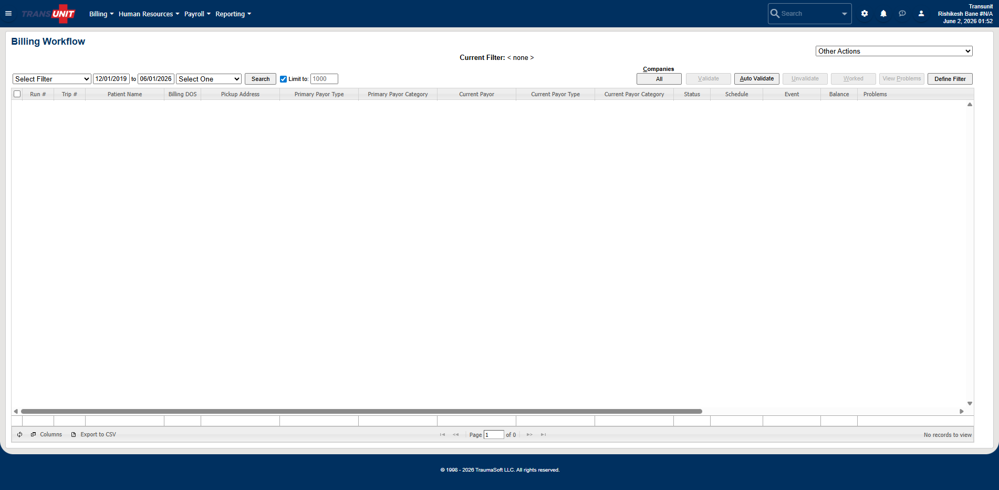

# billing  /  workflow / main

- **Menu section:** Billing
- **URL:** https://transunit.traumasoft.com/main.php?a=billing:workflow/main
- **Title:** Billing Workflow
- **Visited:** yes

## Buttons / actions (sample)

- Billing
- Human Resources
- Payroll
- Reporting
- Search
- All
- Validate
- Auto Validate
- Unvalidate
- Worked
- View Problems
- Define Filter
- Columns
- Export to CSV

## Form fields (sample)

- `input` (text) search_input / search_input / Search
- `select` (select-one) app_view_workflowFilter
- `input` (text) app_view_startDate / mm/dd/yyyy
- `input` (text) app_view_endDate / mm/dd/yyyy
- `select` (select-one) app_view_FilterType
- `input` (checkbox) app_view_limitTrips
- `input` (number) app_view_limitValue / 1000
- `select` (select-one) app_view_otherActions
- `input` (checkbox) cb_workflow_grid_Grid
- `input` (text) Page No.

## Counts

- Tables: 5
- Forms: 0
- In-app links on page: 13

## Subpages / links on this page

- billing  /  workflow / main → `https://transunit.traumasoft.com/main.php?a=billing:workflow/main#`
- user  /  account → `https://transunit.traumasoft.com/main.php?a=user:account`
- billing  /  workflow / main → `https://transunit.traumasoft.com/main.php?a=billing:workflow/main`
- forms  /  anonymous reports main → `https://transunit.traumasoft.com/main.php?a=forms:anonymous_reports_main`
- payroll  /  discrepancy report → `https://transunit.traumasoft.com/main.php?a=payroll:discrepancy_report`
- reportbuilder  /  payroll → `https://transunit.traumasoft.com/main.php?a=reportbuilder:payroll`
- reporting  /  calltype groups / main → `https://transunit.traumasoft.com/main.php?a=reporting:calltype_groups/main`
- reporting  /  cost center groups / main → `https://transunit.traumasoft.com/main.php?a=reporting:cost_center_groups/main`
- reporting  /  kaiser / main → `https://transunit.traumasoft.com/main.php?a=reporting:kaiser/main`
- reporting  /  payor groups / main → `https://transunit.traumasoft.com/main.php?a=reporting:payor_groups/main`
- reporting  /  home → `https://transunit.traumasoft.com/main.php?a=reporting:home`
- reporting  /  dashboard → `https://transunit.traumasoft.com/main.php?a=reporting:dashboard`
- reporting  /  config → `https://transunit.traumasoft.com/main.php?a=reporting:config`

## Screenshot

