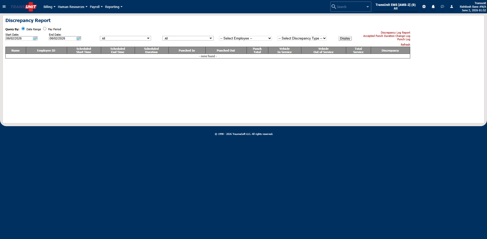

# payroll  /  discrepancy report

- **Menu section:** Payroll
- **URL:** https://transunit.traumasoft.com/main.php?a=payroll:discrepancy_report
- **Title:** Discrepancy Report
- **Visited:** yes

## Buttons / actions (sample)

- Billing
- Human Resources
- Payroll
- Reporting
- TransUnit EMS [AMB-2] (B) All

## Form fields (sample)

- `input` (text) search_input / search_input / Search
- `input` (radio) query_type_date_range / query_type
- `input` (radio) query_type_pay_period / query_type
- `input` (text) start_date / start_date
- `input` (text) end_date / end_date
- `select` (select-one) employee / employee
- `select` (select-one) discrepancy_type / discrepancy_type
- `input` (submit) submit_date / submit_date

## Counts

- Tables: 5
- Forms: 1
- In-app links on page: 13

## Subpages / links on this page

- payroll  /  discrepancy report → `https://transunit.traumasoft.com/main.php?a=payroll:discrepancy_report#`
- user  /  account → `https://transunit.traumasoft.com/main.php?a=user:account`
- billing  /  workflow / main → `https://transunit.traumasoft.com/main.php?a=billing:workflow/main`
- forms  /  anonymous reports main → `https://transunit.traumasoft.com/main.php?a=forms:anonymous_reports_main`
- payroll  /  discrepancy report → `https://transunit.traumasoft.com/main.php?a=payroll:discrepancy_report`
- reportbuilder  /  payroll → `https://transunit.traumasoft.com/main.php?a=reportbuilder:payroll`
- reporting  /  calltype groups / main → `https://transunit.traumasoft.com/main.php?a=reporting:calltype_groups/main`
- reporting  /  cost center groups / main → `https://transunit.traumasoft.com/main.php?a=reporting:cost_center_groups/main`
- reporting  /  kaiser / main → `https://transunit.traumasoft.com/main.php?a=reporting:kaiser/main`
- reporting  /  payor groups / main → `https://transunit.traumasoft.com/main.php?a=reporting:payor_groups/main`
- reporting  /  home → `https://transunit.traumasoft.com/main.php?a=reporting:home`
- reporting  /  dashboard → `https://transunit.traumasoft.com/main.php?a=reporting:dashboard`
- reporting  /  config → `https://transunit.traumasoft.com/main.php?a=reporting:config`

## Screenshot

